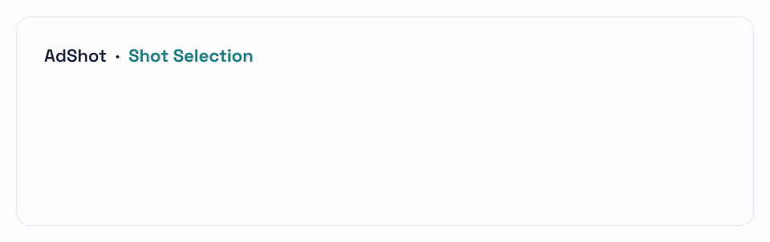

# AdShot

Builds and benchmarks **AdShot**, a dataset of paired 30 s / 15 s cuts of the same TV ad with a shot-level mapping between them. The task: given the shots of a 30 s ad, choose the shots that make up its 15 s version.



```
video_curation/   ──►  pair_extraction/  ──►  AdShot823.csv  ──►  evaluations/    (zero-shot MLLM benchmark)
 videos +               shot detection,        823 pairs     └──►  qwen_pipeline/  (Qwen3-VL batch eval + LoRA SFT)
 batchN_videos.csv      embeddings, pairing
```

## Folders

| folder | what it does | runs on | docs |
|---|---|---|---|
| `video_curation/` | Finds brand channels, lists uploads, screens for short/long ad candidates (OpenAI embeddings + DBSCAN), downloads with yt-dlp, uploads to the cluster. Outputs `videomedia/<Channel>/<id>.mp4` and `logs/batchN_videos.csv`. | local (Windows/WSL) | [readme](video_curation/readme.md) |
| `pair_extraction/` | Per brand: AutoShot shot detection → keyframes → Swin3D-B embeddings → DBSCAN → shot-overlap matching. Outputs `fullmatch.csv` (the `AdShot823.csv` schema). | cluster, `shot` env | [readme](pair_extraction/readme.md), `THRESHOLDS.md` |
| `evaluations/` | Zero-shot evaluation of video MLLMs (Qwen2.5/3-VL, InternVL, LLaVA-OneVision, MiniCPM-V, Molmo2, Aria, NVILA) on the shot-selection task. Reports accuracy, precision, recall, F1, IoU, AUC. | cluster, `mllm` / `mllm2` envs | [readme](evaluations/readme.md) |
| `qwen_pipeline/` | Train/test split, keyframe cache (HDF5), batched Qwen3-VL-8B inference, LoRA fine-tuning. Reuses the `evaluations/` prompts and metrics. | cluster, `mllm2` env | [training readme](qwen_pipeline/training/README.md), `results/SFT_EVAL_SUMMARY.md` |

## Dataset: `AdShot823.csv`

823 focal (30 s) → target (15 s) pairs produced by `pair_extraction` where every target shot maps to a focal shot. Columns:

| column | meaning |
|---|---|
| `brand_id` | brand |
| `focal_ad_id`, `target_ad_id` | YouTube video IDs (30 s, 15 s) |
| `focal_ad_length`, `target_ad_length` | seconds |
| `focal_shotsplit`, `target_shotsplit` | shot-boundary frame indices |
| `focal_shot_count`, `target_shot_count`, `num_mapped_shots` | shot counts |
| `mapping` | dict focal shot → target shot (`None` = dropped in the 15 s cut) |
| `mapping_degree` | `num_mapped_shots / target_shot_count`; 1.0 for every row (full matches only) |
| `focal_relative_path`, `target_relative_path` | `videomedia/<Channel>/<id>.mp4` |

## Setup

```bash
cp .env.example .env    # API keys, DATA_ROOT, upload target, HF_TOKEN
```

`.env` is gitignored. `video_curation` reads it through `video_curation/paths.py`. Cluster scripts expect `HF_TOKEN` exported in your shell before `sbatch` (sbatch passes your environment through).

Environment and install steps for each part are in its folder's readme.
